# Backend Architecture — Supabase Database Schema

> **Project:** `pdcgcqsgzupoyzklvoju` | **Region:** `ap-northeast-1` | **Postgres:** 17.6

## 1. Table Inventory (26 tables, all RLS-enabled)

| Table | Rows | Purpose |
|---|---|---|
| `volunteers` | 145 | Core user/volunteer profiles |
| `birthday_email_logs` | 0 | Tracks sent birthday greeting emails per volunteer per year |
| `projects` | 14 | Community projects/pods |
| `project_volunteers` | 10 | Volunteer-to-project assignments |
| `events` | 0 | Scheduled events |
| `tasks` | 15 | Assigned volunteer tasks |
| `timesheets` | 286 | Work hour tracking |
| `announcements` | 0 | Admin announcements |
| `notifications` | 293 | User notifications |
| `event_interests` | 0 | Volunteer interest in events |
| `announcement_interests` | 0 | Volunteer interest in announcements |
| `app_roles` | 1 | Application role assignments |
| `project_inquiries` | 3 | External inquiries about projects |
| `project_feedback` | 0 | Project ratings & feedback |
| `project_photos` | 16 | Project gallery images |
| `event_registrations` | 3 | Public event registrations |
| `ideas` | 13 | Volunteer idea submissions |
| `spiritual_tasks` | 16 | Spiritual task definitions (STC) |
| `spiritual_task_assignments` | 1942 | STC assignment tracking |
| `team_meetings` | 1 | Team meeting records |
| `reva_sessions` | 4 | Reva session scheduling |
| `kiva_registrations` | 16 | Kiva session registrations |
| `pathshalas` | 1 | Pathshala (religious school) records |
| `library_books` | 1 | Sanskar Library book catalog |
| `pathshala_assignments` | 1 | Library book set assignments |
| `kiva_sessions` | 2 | Kiva session scheduling |

---

## 2. Detailed Table Schemas

### 2.1 `volunteers` — Core User Table
The central table holding all volunteer profiles. Also used for authentication.

| Column | Type | Nullable | Default | Notes |
|---|---|---|---|---|
| `id` | uuid | NO | `gen_random_uuid()` | Primary key, maps to Supabase Auth `auth.uid()` |
| `ilj_id` | text | NO | — | Auto-generated via `generate_ilj_id()` trigger (e.g. `ILJ-001`) |
| `first_name` | text | NO | — | |
| `middle_name` | text | YES | — | |
| `last_name` | text | NO | — | |
| `dob` | date | NO | — | Date of birth |
| `age` | integer | YES | — | |
| `gender` | text | NO | — | |
| `mobile_number` | text | NO | — | |
| `email` | text | NO | — | Unique, used for Supabase Auth |
| `address_line1` | text | NO | — | |
| `address_line2` | text | YES | — | |
| `district` | text | NO | — | |
| `city` | text | NO | — | |
| `state` | text | NO | — | |
| `pincode` | text | NO | — | |
| `country` | text | NO | — | |
| `sangh_name` | text | YES | — | Religious community affiliation |
| `dharmik_studies` | text | YES | — | Religious education background |
| `qualification` | text | NO | — | Academic qualification |
| `specialization` | text | NO | — | Academic specialization |
| `occupation` | text | NO | — | |
| `occupation_other` | text | YES | — | |
| `hobbies` | text | YES | — | |
| `skills` | text | YES | — | |
| `referred_by` | text | YES | — | |
| `volunteering_preference1` | text | NO | — | Primary volunteering interest |
| `volunteering_preference2` | text | YES | — | |
| `volunteering_preference3` | text | YES | — | |
| `availability_days` | text | NO | — | Weekdays/Weekends |
| `time_commitment` | text | YES | — | |
| `participation_mode` | text | NO | — | On-site/Online |
| `additional_areas` | ARRAY | YES | — | Text array of additional areas |
| `password_hash` | text | NO | — | Plaintext password (synced to Supabase Auth) |
| `kalyan_mitra` | text | YES | — | Name of assigned Kalyan Mitra |
| `team_leader_for` | text | YES | — | Team name if team leader |
| `rank` | text | YES | `'Volunteer'` | Volunteer rank tier |
| `designation` | text | YES | — | Primary organizational designation |
| `secondary_designation` | text | YES | — | e.g. 'Chair Person', 'Vice Chair Person' |
| `is_it_admin` | boolean | YES | `false` | IT admin flag |
| `is_onboarding_team` | boolean | YES | `false` | Onboarding team member flag |
| `is_pod_team` | boolean | YES | `false` | Pod team member flag |
| `onboarding_status` | text | YES | `'pending'` | Onboarding workflow status |
| `assigned_pod` | text | YES | — | Pod assignment |
| `activity_status` | text | YES | `'Active'` | Active/Inactive |
| `created_at` | timestamptz | YES | `now()` | |
| `updated_at` | timestamptz | YES | `now()` | Auto-updated via trigger |

---

### 2.2 `projects` — Community Projects / Pods

| Column | Type | Nullable | Default |
|---|---|---|---|
| `id` | uuid | NO | `gen_random_uuid()` |
| `project_code` | text | NO | — |
| `title` | text | NO | — |
| `description` | text | YES | — |
| `banner_url` | text | YES | — |
| `manager_id` | uuid | YES | — (FK → `volunteers.id`) |
| `status` | text | YES | `'upcoming'` |
| `visibility` | text | YES | `'public'` |
| `next_event_date` | text | YES | — |
| `is_event_registration_enabled` | boolean | YES | `false` |
| `parent_project_id` | uuid | YES | — (self-referencing FK) |
| `registration_link` | text | YES | — |
| `qna_link` | text | YES | — |
| `sub_head_ids` | ARRAY (uuid[]) | YES | `'{}'::uuid[]` |
| `display_sub_heads` | boolean | YES | `false` |
| `created_at` | timestamptz | YES | `now()` |
| `updated_at` | timestamptz | YES | `now()` |

---

### 2.3 `project_volunteers` — Project Assignments

| Column | Type | Default |
|---|---|---|
| `id` | uuid | `gen_random_uuid()` |
| `project_id` | uuid | FK → `projects.id` |
| `volunteer_id` | uuid | FK → `volunteers.id` |
| `assigned_at` | timestamptz | `now()` |
| `status` | text | `'approved'` |
| `engagement_status` | text | `'pending'` |

---

### 2.4 `tasks` — Volunteer Task Assignments

| Column | Type | Default |
|---|---|---|
| `id` | uuid | `gen_random_uuid()` |
| `title` | text | — |
| `description` | text | — |
| `project_id` | uuid | FK → `projects.id` |
| `event_id` | uuid | FK → `events.id` |
| `assignee_id` | uuid | FK → `volunteers.id` |
| `deadline` | timestamptz | — |
| `status` | text | `'pending'` |
| `rating` | integer | — |
| `feedback_comments` | text | — |
| `created_at` | timestamptz | `now()` |

**Status values:** `pending` → `in_progress` → `completed`

---

### 2.5 `timesheets` — Work Hour Tracking

| Column | Type | Default |
|---|---|---|
| `id` | uuid | `gen_random_uuid()` |
| `volunteer_id` | uuid | FK → `volunteers.id` |
| `project_id` | uuid | FK → `projects.id` |
| `event_id` | uuid | FK → `events.id` |
| `role` | text | — |
| `hours` | numeric | — |
| `work_mode` | text | — (On-site/Online) |
| `description` | text | — |
| `status` | text | `'pending'` |
| `date_worked` | date | — |
| `created_at` | timestamptz | `now()` |

**Status values:** `pending` → `approved` / `rejected`

---

### 2.6 `events` — Event Scheduling

| Column | Type | Default |
|---|---|---|
| `id` | uuid | `gen_random_uuid()` |
| `project_id` | uuid | FK → `projects.id` |
| `title` | text | — |
| `date` | timestamptz | — |
| `role_needed` | text | — |
| `description` | text | — |
| `banner_url` | text | — |
| `created_at` | timestamptz | `now()` |

---

### 2.7 `ideas` — Volunteer Ideas

| Column | Type | Default |
|---|---|---|
| `id` | uuid | `gen_random_uuid()` |
| `title` | text | — |
| `description` | text | — |
| `project_id` | uuid | FK → `projects.id` |
| `submitted_by` | uuid | FK → `volunteers.id` |
| `status` | text | `'pending'` |
| `admin_notes` | text | — |
| `created_at` | timestamptz | `now()` |
| `updated_at` | timestamptz | `now()` |

**Status values:** `pending` → `approved` / `rejected`

---

### 2.8 `spiritual_tasks` — STC Task Definitions

| Column | Type | Default |
|---|---|---|
| `id` | uuid | `gen_random_uuid()` |
| `title` | text | — |
| `description` | text | — |
| `assignment_type` | text | `'specific'` |
| `created_by` | uuid | FK → `volunteers.id` |
| `created_at` | timestamptz | `now()` |
| `updated_at` | timestamptz | `now()` |

### 2.9 `spiritual_task_assignments` — STC Tracking (1942 rows)

| Column | Type | Default |
|---|---|---|
| `id` | uuid | `gen_random_uuid()` |
| `task_id` | uuid | FK → `spiritual_tasks.id` |
| `volunteer_id` | uuid | FK → `volunteers.id` |
| `status` | text | `'pending'` |
| `completed_at` | timestamptz | — |
| `created_at` | timestamptz | `now()` |

---

### 2.10 `notifications`

| Column | Type | Default |
|---|---|---|
| `id` | uuid | `gen_random_uuid()` |
| `user_id` | uuid | FK → `volunteers.id` |
| `message` | text | — |
| `is_read` | boolean | `false` |
| `type` | text | — (e.g. `reva_event`, `kiva_event`) |
| `created_at` | timestamptz | `now()` |

---

### 2.11 `announcements`

| Column | Type | Default |
|---|---|---|
| `id` | uuid | `gen_random_uuid()` |
| `title` | text | — |
| `message` | text | — |
| `created_by` | text | — |
| `type` | text | `'general'` |
| `project_id` | uuid | FK → `projects.id` |
| `deadline` | timestamptz | — |
| `created_at` | timestamptz | `now()` |

---

### 2.12 Other Tables (abbreviated)

#### `event_registrations` — Public event signups
Key fields: `project_id`, `full_name`, `whatsapp_number`, `email`, `dob`, `age`, `address`, `sangh_name`, `payment_screenshot_url`, `fathers_name`, `emergency_contact_*`, `is_vihar_sevika`, `photograph_url`, `medical_information`

#### `event_interests` / `announcement_interests`
Junction tables: `(event_id|announcement_id, volunteer_id, created_at)`

#### `project_inquiries` — External inquiries
Key fields: `project_id`, `name`, `email`, `mobile`, `message`, `sangh_name`, `sangh_address`, `proposed_venue`, `proposed_dates`, `how_did_you_know`

#### `project_feedback` — Ratings & comments
Key fields: `project_id`, `event_id`, `rating`, `comments`, `name`, `mobile`, `email`, `age`, `city`, `is_anonymous`, `is_featured`

#### `project_photos`
Fields: `project_id`, `photo_url`

#### `kiva_registrations` — Kiva session signups
Key fields: `project_id`, `is_ilj_volunteer`, `ilj_id`, `full_name`, `mobile_number`, `preferred_dates`, `attendance_status`, `attended_event_id`

#### `kiva_sessions` / `reva_sessions` — Session scheduling
Fields: `date`, `time`, `venue`

#### `team_meetings`
Fields: `team_leader_id`, `team_name`, `title`, `meeting_date`, `meeting_link`, `minutes`

#### `pathshalas` — Religious school records
Fields: `name`, `sangh_name`, `contact_person`, `mobile_number`, `email`, `address`, `city`, `state`, `pincode`

#### `pathshala_assignments` — Book set assignments to pathshalas
Fields: `pathshala_id`, `set_no`, `date_of_issue`, `date_of_renewal`

#### `library_books` — Library catalog
Fields: `book_no`, `book_name`, `author`, `publisher`, `language`, `set_no`

#### `app_roles`
Fields: `user_id`, `role`

---

## 3. Entity Relationship Diagram

```mermaid
erDiagram
    volunteers ||--o{ project_volunteers : "assigned to"
    volunteers ||--o{ tasks : "assigned"
    volunteers ||--o{ timesheets : "logs"
    volunteers ||--o{ notifications : "receives"
    volunteers ||--o{ ideas : "submits"
    volunteers ||--o{ spiritual_task_assignments : "assigned"
    volunteers ||--o{ event_interests : "interested in"
    volunteers ||--o{ announcement_interests : "interested in"

    projects ||--o{ project_volunteers : "has"
    projects ||--o{ events : "contains"
    projects ||--o{ tasks : "contains"
    projects ||--o{ timesheets : "tracked under"
    projects ||--o{ announcements : "related to"
    projects ||--o{ project_inquiries : "receives"
    projects ||--o{ project_feedback : "receives"
    projects ||--o{ project_photos : "has"
    projects ||--o{ event_registrations : "has"
    projects ||--o{ ideas : "related to"
    projects ||--o{ kiva_registrations : "has"
    projects }o--|| volunteers : "managed by (manager_id)"
    projects }o--o| projects : "child of (parent_project_id)"

    events ||--o{ event_interests : "has"
    events ||--o{ tasks : "for"
    events ||--o{ timesheets : "for"

    spiritual_tasks ||--o{ spiritual_task_assignments : "has"

    announcements ||--o{ announcement_interests : "has"

    pathshalas ||--o{ pathshala_assignments : "has"

    kiva_sessions ||--o{ kiva_registrations : "attended via"
```

---

## 4. Database Triggers

| Trigger | Table | Timing | Event | Function |
|---|---|---|---|---|
| `set_ilj_id` | `volunteers` | BEFORE | INSERT | `generate_ilj_id()` — auto-assigns ILJ-NNN |
| `on_volunteer_created` | `volunteers` | AFTER | INSERT | `handle_new_volunteer()` — creates Supabase Auth user |
| `update_volunteers_updated_at` | `volunteers` | BEFORE | UPDATE | `update_updated_at_column()` |
| `on_volunteer_password_change` | `volunteers` | AFTER | UPDATE | `sync_volunteer_password_to_auth()` — syncs to Auth |
| `trigger_update_st_updated_at` | `spiritual_tasks` | BEFORE | UPDATE | `set_updated_at()` |

---

## 5. RPC Functions (17 total)

| Function | Return Type | Purpose |
|---|---|---|
| `get_todays_birthdays` | table | Finds volunteers with birthdays today in IST who haven't received an email this year |
| `register_volunteer_secure` | json | Registers new volunteer (creates DB record + Auth user) |
| `login_volunteer` | json | Validates ILJ ID + password, returns user data |
| `reset_volunteer_password` | json | Resets volunteer password |
| `force_sync_auth_password` | json | Force-syncs volunteer password to Supabase Auth |
| `generate_ilj_id` | trigger | Auto-generates sequential ILJ IDs |
| `handle_new_volunteer` | trigger | Creates corresponding Supabase Auth user on INSERT |
| `sync_volunteer_password_to_auth` | trigger | Syncs password changes to Auth on UPDATE |
| `update_updated_at_column` | trigger | Updates `updated_at` timestamp |
| `set_updated_at` | trigger | Updates `updated_at` timestamp (for spiritual_tasks) |
| `is_admin` | boolean | Checks if current user is admin |
| `get_user_privilege_level` | text | Returns user privilege level (admin/manager/team_leader/volunteer) |
| `verify_ilj_login` | text | Legacy login verification |
| `register_event_interest` | jsonb | Registers volunteer interest in an event |
| `revoke_event_interest` | jsonb | Removes volunteer interest in an event |
| `register_announcement_interest` | jsonb | Registers interest in an announcement |
| `is_allowed_origin` | boolean | CORS origin validation |

---

## 6. Edge Functions (7)

| Function | Purpose | JWT Verify |
|---|---|---|
| `send-birthday-email` | Sends automated birthday greetings with QR donation code (daily via pg_cron) | No |
| `send-welcome-email` | Sends welcome email on volunteer registration | No |
| `send-task-email` | Sends email when task is assigned | No |
| `send-event-registration-email` | Sends confirmation for event registration | No |
| `assign-kalyan-mitra` | Assigns Kalyan Mitra to volunteer | No |
| `notify-pod-assignment` | Notifies volunteer of pod assignment | No |
| `system-migration` | Database migration utility | No |

---

## 7. Supabase Storage Buckets

Used for storing:
- **Project photos** — uploaded via admin, stored URLs in `project_photos.photo_url`
- **Payment screenshots** — uploaded during event registration, stored in `event_registrations.payment_screenshot_url`
- **Volunteer photographs** — uploaded during event registration, stored in `event_registrations.photograph_url`
